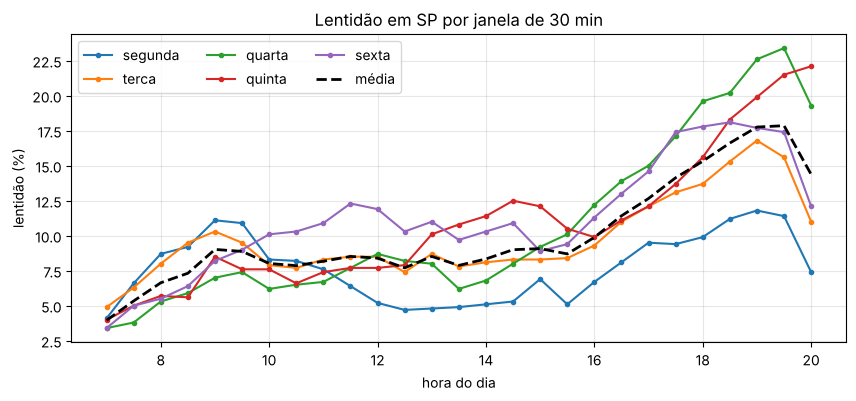
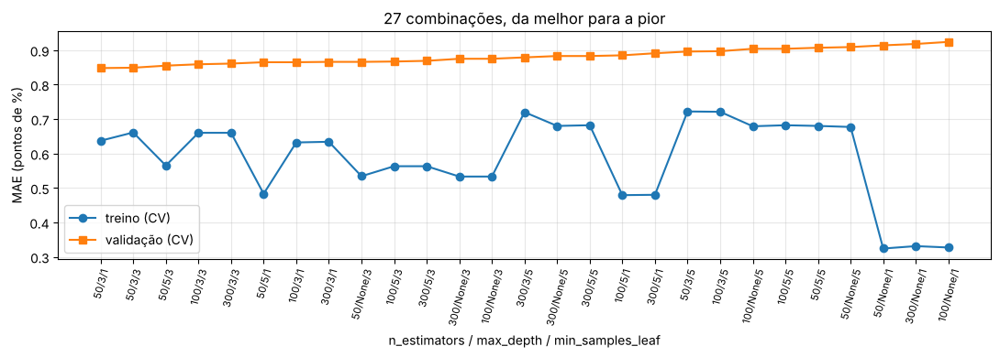
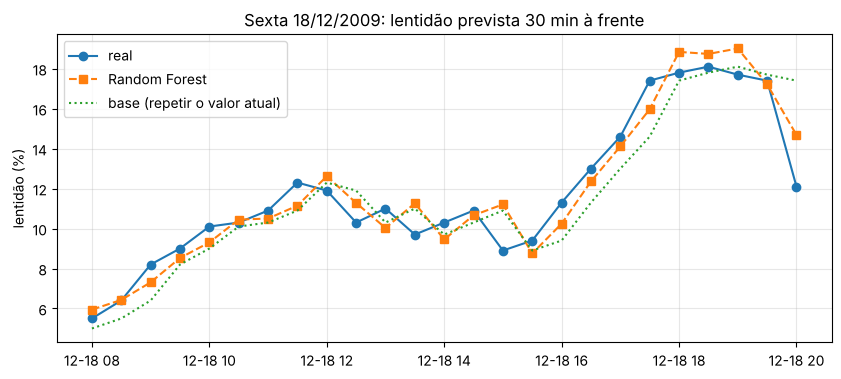
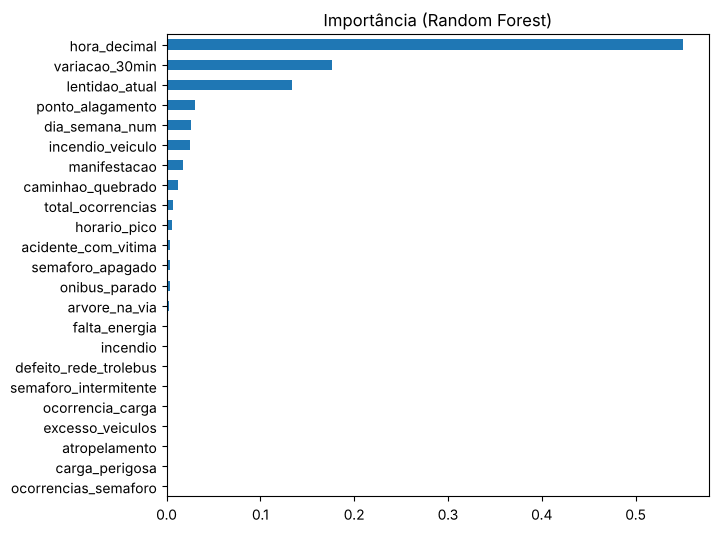

# Relatório de Machine Learning · Semáforo Inteligente

**CitizenTech:** Semáforo Inteligente · **Disciplina:** Inteligência Artificial & Machine Learning · **Equipe:** Eduardo Tomazela (RM556807) · Luiz Henrique Silva (RM555235) · Léo Masago (RM557768)

## 1. Problema e pergunta de ML

Em São Paulo, a maioria dos semáforos funciona em ciclos fixos: o tempo de verde é o mesmo às 7h e às 19h. Quem volta do trabalho no fim da tarde perde tempo parado, e ambulâncias ficam presas justamente nos horários em que a cidade mais trava. O Semáforo Inteligente só consegue agir antes do congestionamento se souber o que vem pela frente.

**Pergunta de ML:** *dado o horário, o dia da semana, a lentidão atual e as ocorrências registradas, qual será a lentidão do trânsito de São Paulo nos próximos 30 minutos?* É um problema de **regressão** sobre série temporal.

## 2. Dados reais

| Item | Detalhe |
| --- | --- |
| Dataset | *Behavior of the urban traffic of the city of São Paulo in Brazil* (dados da CET-SP) |
| Fonte | UCI Machine Learning Repository, https://archive.ics.uci.edu/dataset/483 (licença CC BY 4.0) |
| Período | 14/12/2009 (segunda) a 18/12/2009 (sexta), das 7h00 às 20h00 |
| Tamanho | 135 registros, um a cada 30 minutos; 16 tipos de ocorrência + % de lentidão |
| Dados pessoais | nenhum |

A exploração (`01_analise_exploratoria.ipynb`) mostrou que **o horário domina**: a lentidão média vai de 4,6% às 7h para 17,8% às 19h, e a semana piora até a sexta. Quando há semáforo apagado ou intermitente, a lentidão média sobe de 9,7% para 12,9%. A lentidão de uma janela tem correlação de 0,95 com a da janela seguinte.

## 3. Escolha do modelo: Random Forest

- A relação entre hora e lentidão **não é linear** (picos de manhã e à tarde) e há interações entre hora, dia e ocorrências; árvores capturam isso naturalmente.
- O conjunto é **pequeno e misto** (contagens, percentuais, horário). A floresta não precisa de escalonamento e, por ser uma média de várias árvores, é menos sensível a ruído do que uma árvore única ou uma rede neural (MLP/LSTM precisariam de muito mais dados).
- Mostra a **importância das variáveis**, o que ajuda a explicar a decisão para a central de trânsito.

## 4. Preparação e divisão treino/teste

Em `02_preparacao.ipynb`:

1. **Limpeza:** tradução das colunas, reconstrução da data/hora a partir da hora codificada (1 = 7h00 … 27 = 20h00), validação de faixas (0–100% de lentidão, contagens ≥ 0). Não havia ausentes nem duplicados.
2. **Variáveis:** `hora_decimal`, `dia_semana_num`, `horario_pico`, `lentidao_atual`, `variacao_30min` (tendência da última meia hora), `total_ocorrencias`, `ocorrencias_semaforo` e as 16 ocorrências.
3. **Alvo:** lentidão 30 minutos à frente, calculada dentro de cada dia. O modelo é treinado na **variação** (`próxima − atual`) e a previsão final é `lentidao_atual + variação prevista`. Na primeira tentativa, prevendo o nível direto, o modelo deu 94% da importância à lentidão atual e só copiou esse valor, empatando com a linha de base.
4. **Divisão temporal:** treino = segunda a quinta (100 linhas); teste = sexta (25 linhas), um dia inteiro que o modelo nunca viu. Uma divisão aleatória colocaria janelas vizinhas nos dois lados e daria uma nota otimista.

## 5. Treino com diferentes hiperparâmetros

`GridSearchCV` em `03_treino_random_forest.ipynb`, com **27 combinações** de 3 hiperparâmetros:

| Hiperparâmetro | Valores |
| --- | --- |
| `n_estimators` | 50, 100, 300 |
| `max_depth` | 3, 5, None |
| `min_samples_leaf` | 1, 3, 5 |

A validação cruzada usa **só o treino**, com `GroupKFold` por dia (4 dobras, cada uma deixa um dia inteiro de fora), e métrica MAE. Tabela completa em `resultados_grid.csv`.

| Configuração | MAE treino (CV) | MAE validação (CV) |
| --- | --- | --- |
| **50 / 3 / 1 (melhor)** | 0,64 | **0,85** |
| 50 / 5 / 3 | 0,57 | 0,86 |
| 300 / 3 / 3 | 0,66 | 0,86 |
| 50 / None / 1 | 0,32 | 0,91 |
| 100 / None / 1 (pior) | 0,33 | 0,92 |

## 6. Resultados em treino e teste

| Modelo | MAE treino | MAE teste | RMSE treino | RMSE teste | R² treino | R² teste |
| --- | --- | --- | --- | --- | --- | --- |
| Linha de base (repetir a lentidão atual) | – | 1,19 | – | 1,60 | – | 0,79 |
| **Random Forest (50 / 3 / 1)** | 0,65 | **0,88** | 0,82 | **1,07** | 0,96 | **0,91** |

*MAE e RMSE em pontos percentuais de lentidão.*

**Overfitting:** as árvores sem limite de profundidade (`max_depth=None`, folhas de 1 amostra) tiveram o menor erro de treino (0,32) e o maior de validação (0,92): decoraram os 4 dias. A busca escolheu árvores rasas (`max_depth=3`), e a diferença final entre treino e teste ficou em 0,23 ponto, com R² de 0,96 para 0,91. Há um leve sobreajuste, esperado num conjunto pequeno, mas o modelo se mantém num dia novo.

**O que o modelo aprendeu:** o horário responde por cerca de 55% da importância, seguido da tendência dos últimos 30 minutos (18%) e da lentidão atual (13%). Ele sabe que no fim da tarde o trânsito tende a piorar, antes de piorar.

## 7. Conclusão para o cidadão

O modelo prevê a lentidão da cidade com 30 minutos de antecedência e erro médio de **0,88 ponto percentual**, **26% melhor** do que supor que o trânsito vai continuar como está. Para a central do Semáforo Inteligente, isso significa esticar o verde das vias principais **antes** da fila se formar, principalmente entre 17h e 20h, quando o modelo antecipa a subida da lentidão. Na prática: menos tempo parado para quem volta do trabalho, menos combustível queimado em marcha lenta e ruas mais livres para as ambulâncias no horário mais crítico. A análise também mostra que semáforos com falha coincidem com mais lentidão, o que reforça o valor de monitorar cada cruzamento.

**Limitações e próximos passos:** os dados cobrem só 5 dias úteis de dezembro de 2009, sem fins de semana, feriados ou chuva. O próximo passo é retreinar com a série histórica de lentidão da CET de 2001 a 2019 (Kaggle, `danlessa/sao-paulo-traffic-jams-since-2001`), somar chuva por hora do INMET e comparar com XGBoost.
